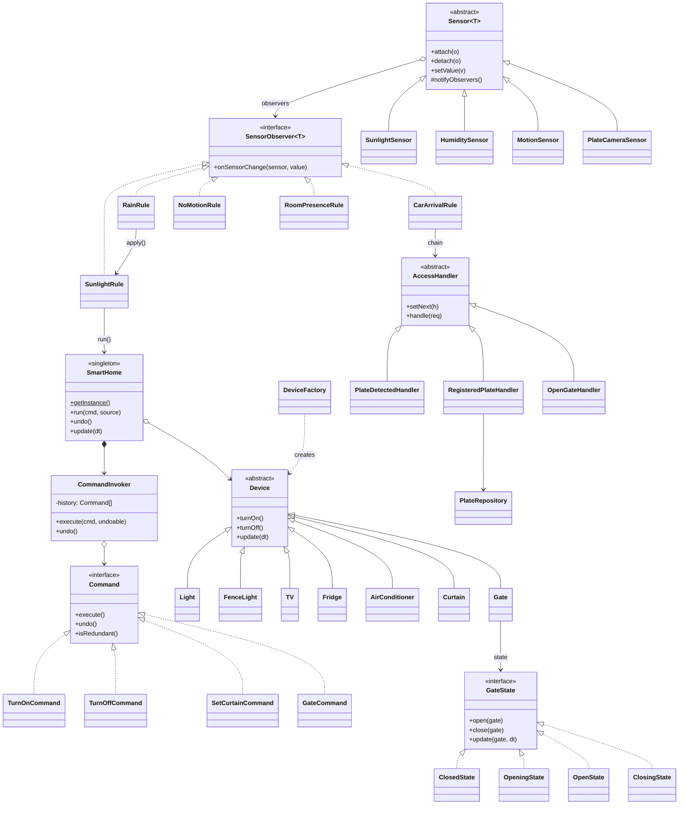
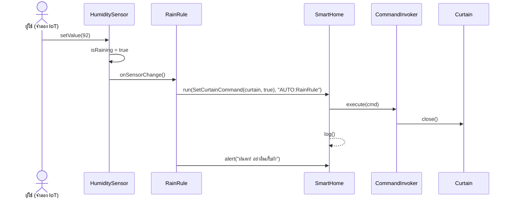

# รายงาน Mini Project: Pixel Smart Home

วิชา 1144351 Pattern and Software Design

## 1. ซอฟต์แวร์

**Pixel Smart Home** เป็น Web app เขียนด้วย TypeScript (ภาษาเชิงวัตถุ มี class, interface, abstract class) ใช้ Vite เป็นเครื่องมือ build และวาดภาพด้วย HTML Canvas

ระบบจำลองบ้านอัจฉริยะที่สั่งงานอุปกรณ์ในบ้านอัตโนมัติจากค่าเซ็นเซอร์ IoT ส่วน IoT เป็นการจำลอง (mock) ผู้ใช้ปรับค่าเซ็นเซอร์เองบนหน้าจอได้

| ส่วนของหน้าจอ | หน้าที่ |
|---|---|
| ภาพบ้าน 2D แบบพิกเซล | แสดงสถานะอุปกรณ์ทุกตัวแบบเกม เช่น ไฟเรืองแสง ทีวีกระพริบ แอร์มีลม ผ้าม่านเลื่อน ประตูรั้วยก รถวิ่งเข้าบ้าน ฝนตก กลางวัน/กลางคืน คลิกอุปกรณ์ในภาพเพื่อเปิด/ปิดได้ |
| จำลองค่าจาก IoT Sensor | slider แสงแดด, slider ความชื้น, ปุ่ม motion sensor, กล้องอ่านป้ายทะเบียน |
| ควบคุมอุปกรณ์ (Manual) | ปุ่มเปิด/ปิดอุปกรณ์ทุกตัว และปุ่ม Undo |
| ป้ายทะเบียนที่อนุญาต | เพิ่ม/ลบป้ายทะเบียนในฐานข้อมูล (เก็บใน localStorage) |
| บันทึกการทำงาน | แสดงทุกคำสั่งว่าใครเป็นผู้สั่ง: `MANUAL`, `AUTO:<ชื่อกฎ>`, `DEVICE`, `SYSTEM` |

อุปกรณ์ในบ้าน: ทีวี, ตู้เย็น, แอร์ 2 เครื่อง, ไฟในบ้าน 3 ห้อง, ไฟรอบรั้ว, ไฟเสาประตูรั้ว, ผ้าม่านอัตโนมัติ 3 บาน และประตูรั้วหน้าบ้าน

## 2. วัตถุประสงค์ของซอฟต์แวร์

1. ให้บ้านจัดการอุปกรณ์ได้เองตามสภาพแวดล้อม (แสงแดด ฝน การเคลื่อนไหว รถที่มาถึง) โดยผู้ใช้ไม่ต้องสั่งเอง
2. เปิดประตูรั้วให้เฉพาะรถที่ลงทะเบียนไว้ แล้วปิดประตูเองอัตโนมัติ
3. ประหยัดพลังงาน โดยปิดไฟ ทีวี และแอร์เมื่อไม่มีคนอยู่
4. ผู้ใช้ยังควบคุมอุปกรณ์เองได้ทุกตัว ย้อนกลับคำสั่งได้ และตรวจสอบย้อนหลังได้ว่าอุปกรณ์ถูกสั่งจากใคร

### Use case ที่รองรับ

| UC | เหตุการณ์ | สิ่งที่ระบบทำ |
|---|---|---|
| 1 | รถขับมาหน้าบ้าน กล้องอ่านป้ายทะเบียน | ถ้าป้ายลงทะเบียนไว้ จะเปิดประตูรั้ว แล้วปิดเองหลังจาก 5 วินาที |
| 2 | แสงแดดหมด / มีแสงแดด | เปิด / ปิดไฟรอบรั้ว |
| 3 | มีแสงแดด / แสงแดดหมด | เลื่อนผ้าม่านลง / ขึ้น |
| 4 | ความชื้นสูง (ฝนตก) | เลื่อนผ้าม่านลง เปิดไฟรั้ว และแจ้งเตือนให้เก็บผ้า เมื่อฝนหยุดจะกลับไปทำงานตามแสงแดด |
| 5 | รถเจ้าของบ้านเข้าบ้าน | เปิดแอร์และไฟห้องนั่งเล่นอัตโนมัติ (ไฟจะปิดพร้อมแอร์เมื่อไม่พบคนในบ้าน) |
| 6 | ไม่พบคนในห้องใดเลยเกินเวลาที่กำหนด | ปิดไฟในบ้าน ทีวี และแอร์ (ตู้เย็นยังทำงานต่อ) |
| 7 | คนย้ายห้อง (มี motion sensor แยกห้องนั่งเล่น ห้องครัว ห้องนอน) | ห้องที่มีคนเข้าไป: เปิดไฟและแอร์ทันที ส่วนห้องที่ไม่มีคน: **หน่วงเวลา** (ค่าเริ่มต้น 5 วินาที ปรับได้) แล้วค่อยปิดไฟ แอร์ และทีวี ถ้ากลับเข้าห้องก่อนครบเวลาจะยกเลิกการปิด เช่น ไปห้องนอนจะปิดไฟ/แอร์/ทีวีห้องนั่งเล่นและไฟห้องครัว กลับมาห้องนั่งเล่นจะเปิดไฟ/แอร์ห้องนั่งเล่นและปิดของห้องนอน |

## 3. ปัญหาที่คาดว่าจะเกิดขึ้น

บ้านอัจฉริยะมี **เซ็นเซอร์หลายตัว** ที่ต้องสั่ง **อุปกรณ์หลายตัว** และคำสั่งมาจาก **สองทาง** คือระบบอัตโนมัติและผู้ใช้กดเอง ถ้าเขียนแบบตรงไปตรงมาจะเจอปัญหาดังนี้

1. **โค้ดผูกกันแน่น (tight coupling)**
   - เซ็นเซอร์ต้องรู้จักอุปกรณ์ทุกตัวที่ต้องสั่ง
   - โค้ดจะกลายเป็น `if-else` ก้อนใหญ่ เช่น `if (แสง < 30) { ไฟรั้ว.on(); ม่าน1.open(); ม่าน2.open(); ... } if (ความชื้น > 85) {...}`
   - เพิ่มเซ็นเซอร์หรือกฎใหม่ทีไรต้องแก้โค้ดเดิม ซึ่งผิดหลัก Open/Closed Principle
2. **กฎทำงานซ้อนกัน**
   - เหตุการณ์หนึ่งต้องทำหลายอย่างพร้อมกัน
   - บางเหตุการณ์ขัดกัน เช่น กลางคืนต้องเปิดม่าน แต่ถ้าฝนตกต้องปิดม่าน
3. **ตรวจสอบย้อนหลังและย้อนกลับไม่ได้**
   - เมื่ออุปกรณ์เปิด/ปิดเอง ผู้ใช้ไม่รู้ว่าเกิดจากกฎไหนหรือใครสั่ง
   - ถ้าผู้ใช้กดผิดก็ย้อนกลับไม่ได้
4. **อุปกรณ์ที่มีหลายสถานะ** เช่น ประตูรั้วที่มีสถานะ ปิด → กำลังเปิด → เปิด → กำลังปิด
   - ถ้าใช้ตัวแปรสถานะกับ `switch` จะเกิดบั๊กง่าย เช่น สั่งปิดขณะกำลังเปิดอยู่
5. **การตรวจสิทธิ์รถมีหลายขั้นตอน** ได้แก่ อ่านป้ายได้หรือไม่ → ป้ายลงทะเบียนหรือไม่ → เปิดประตู
   - ในอนาคตอาจต้องเพิ่มขั้น เช่น blacklist หรือช่วงเวลาที่อนุญาต

## 4. Pattern ที่เลือกใช้

### Pattern หลัก: Observer + Command

#### Observer Pattern: แก้ปัญหาข้อ 1 และ 2

| บทบาท | คลาส |
|---|---|
| Observer (interface) | `SensorObserver<T>` (`src/sensors/Sensor.ts`) |
| Subject | `Sensor<T>` (abstract class) มี `attach()`, `detach()`, `notifyObservers()` |
| Concrete Subject | `SunlightSensor`, `HumiditySensor`, `MotionSensor` (ห้องละ 1 ตัว), `PlateCameraSensor` |
| Concrete Observer | `SunlightRule`, `RainRule`, `CarArrivalRule`, `RoomPresenceRule`, `NoMotionRule` (`src/automation/`) |

```ts
sensors.sunlight.attach(rules.sunlight);     // UC2, UC3
sensors.humidity.attach(rules.rain);         // UC4
sensors.plateCamera.attach(rules.carArrival); // UC1, UC5
for (const motion of Object.values(sensors.motion)) {  // ห้องนั่งเล่น ห้องครัว ห้องนอน
  motion.attach(rules.roomPresence);           // UC7
  motion.attach(rules.noMotion);               // UC6
}
```

เมื่อค่าเซ็นเซอร์เปลี่ยน (`setValue`) เซ็นเซอร์จะแจ้งกฎทุกตัวที่ลงทะเบียนไว้ โดยไม่ต้องรู้ว่ากฎเหล่านั้นคืออะไร

#### Command Pattern: แก้ปัญหาข้อ 3

| บทบาท | คลาส |
|---|---|
| Command (interface) | `Command` มี `execute()`, `undo()`, `isRedundant()` |
| Concrete Command | `TurnOnCommand`, `TurnOffCommand`, `SetCurtainCommand`, `GateCommand` |
| Invoker | `CommandInvoker` (เก็บประวัติเพื่อ undo) |
| Receiver | อุปกรณ์ต่าง ๆ (`Device` และคลาสลูก) |
| Client | กฎอัตโนมัติ และปุ่มบน UI |

ทุกคำสั่ง ทั้งจากกฎอัตโนมัติและจากผู้ใช้ ผ่านเส้นทางเดียวคือ `SmartHome.run(command, source)` ระบบจึงบันทึก log ได้ครบว่าใครสั่งอะไร คำสั่ง manual ย้อนกลับได้ด้วยปุ่ม Undo และคำสั่งที่ไม่เปลี่ยนอะไร (`isRedundant`) จะถูกข้ามไป

### Pattern เสริม

| Pattern | ใช้ที่ | แก้ปัญหา |
|---|---|---|
| **State** | `Gate` + `ClosedState`, `OpeningState`, `OpenState`, `ClosingState` (`src/devices/gate/`) | ข้อ 4: แต่ละสถานะกำหนดเองว่าจะตอบสนองต่อ `open()`, `close()` และเวลาที่ผ่านไปอย่างไร เช่น สั่งเปิดขณะกำลังปิดจะเปิดกลับทันทีเพื่อความปลอดภัย และสถานะเปิดจะนับถอยหลังแล้วปิดเอง |
| **Chain of Responsibility** | `PlateDetectedHandler → RegisteredPlateHandler → OpenGateHandler` (`src/access/`) | ข้อ 5: ตรวจสิทธิ์รถทีละขั้น เพิ่มขั้นใหม่ได้โดยต่อ handler เข้าไปใน chain |
| **Factory** | `DeviceFactory.create(type, id, name, zone)` | สร้างอุปกรณ์ทั้งหมดจากตาราง config (`DEVICE_CONFIG`) โดยโค้ดส่วนอื่นไม่ต้องรู้จักคลาสจริง |
| **Singleton** | `SmartHome.getInstance()` | มีศูนย์กลางควบคุมบ้านเพียงตัวเดียว ถือรายการอุปกรณ์ กฎ invoker และ log |

## 5. เหตุผลที่เลือกใช้ pattern

- **Observer**: ปัญหาหลักคือความสัมพันธ์แบบหนึ่งต่อหลาย (one-to-many) ระหว่างเซ็นเซอร์กับการกระทำที่ต้องเกิดขึ้น Observer จึงเหมาะที่สุด
  - เพิ่มกฎใหม่ได้โดยสร้างคลาสใหม่แล้ว `attach` เข้ากับเซ็นเซอร์ ไม่ต้องแก้คลาสเซ็นเซอร์เดิม (Open/Closed Principle)
  - แต่ละกฎรับผิดชอบ use case ของตัวเองเพียงเรื่องเดียว (Single Responsibility)
  - ตัวอย่างจริงในโปรเจกต์: ตอนเพิ่มการตรวจจับคนแยกห้อง (UC7) ทำแค่สร้าง `RoomPresenceRule` แล้ว attach เข้ากับ motion sensor ของแต่ละห้อง โดยไม่ต้องแก้คลาสเซ็นเซอร์หรือกฎเดิม
  - กฎที่ขัดกันจัดการได้ชัดเจนในจุดเดียว เช่น `SunlightRule.apply()` ตรวจ `humidity.isRaining` ก่อนเปิดม่าน
- **Command**: ทำให้คำสั่งกลายเป็นอ็อบเจกต์ จึงเก็บ ส่งต่อ บันทึก และย้อนกลับได้
  - ทั้งคำสั่งอัตโนมัติและคำสั่ง manual ใช้ระบบเดียวกัน
  - ผู้ใช้ตรวจสอบย้อนหลังได้ใน log และ undo ได้
- **State**: ประตูรั้วมีพฤติกรรมต่างกันชัดเจนในแต่ละสถานะ การแยกเป็นคลาสช่วยตัด `if/switch` ที่ซับซ้อนออก และเพิ่มสถานะใหม่ได้ง่าย เช่น "ติดขัด"
- **Chain of Responsibility**: การตรวจสิทธิ์เป็นลำดับขั้นที่อาจหยุดกลางทางได้ แยกแต่ละขั้นเป็น handler ทำให้ทดสอบและเปลี่ยนลำดับได้ง่าย
- **Factory / Singleton**: ลดการผูกกับคลาสจริงตอนสร้างอุปกรณ์ และรับประกันว่าทั้งระบบใช้ศูนย์ควบคุมเดียวกัน

## Class diagram



## ลำดับการทำงาน: ฝนตก (UC4)



## การทดสอบ

- Unit test 41 กรณีด้วย Vitest (`npm test`) ครอบคลุม UC1–UC7 และพฤติกรรมของแต่ละ pattern
- ทดสอบบน browser จริงครบทุก use case ผ่านหน้า UI
